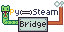

# pySteamBridge

A modern FOSS wrapper for the Steamworks SDK by Valve. This wrapper is
the same one used in **PixelRift**.
This does not redistribute any of Valve's binaries, so you'll need to
bring your own to get the project working.

One folder, no build step, no compiler, and nothing outside the
standard library. It loads Valve's redistributable with `ctypes` and
calls the flat C exports directly, so there is no extension module to
compile and no wheel to match against your interpreter.

```python
from pysteambridge import STEAMWORKS

api = STEAMWORKS()
api.initialize()
api.UserStats.RequestCurrentStats()
api.UserStats.SetAchievement(b"FIRST_WIN")
api.UserStats.StoreStats()
```

## Why this exists

The usual Python route to Steamworks is [SteamworksPy][swpy], which
wraps the SDK in a C++ shim you build yourself. That shim is a real
dependency: a compiler, a matching SDK checkout, and a rebuild for
every platform you ship on.

pySteamBridge skips it. Valve already exports a flat C ABI from the
redistributable (`SteamAPI_ISteamUserStats_SetAchievement` and
friends), which is exactly what `ctypes` can call. The result is a
pure-Python package that ships the same way everywhere.

It keeps SteamworksPy's attribute layout, so code written against that
package runs unchanged.

---

# Getting it running

## 1. Drop it into your project

There is nothing to install. Copy the `pysteambridge/` folder next to
your entry point and import it:

```
yourgame/
    main.py
    pysteambridge/
        __init__.py
        steamworks.py
```

It has no dependencies beyond the standard library, which is what
makes vendoring it the normal way to use it.

Want the `steamworks` import name too? Copy the `steamworks/` folder
across as well. It holds no implementation, only the alias.

## 2. Go and fetch Valve's binary

**No Steamworks binary is included here.** Valve's redistributable is covered by the Steamworks SDK Access Agreement, not by this project's MIT license. Download the SDK from the [Steamworks partner site][sdk] and take the file for your platform out of `sdk/redistributable_bin/`:

| Platform | File | In the SDK zip |
|---|---|---|
| Windows (64-bit) | `steam_api64.dll` | `redistributable_bin/win64/` |
| Windows (32-bit) | `steam_api.dll` | `redistributable_bin/` |
| Linux (64-bit) | `libsteam_api.so` | `redistributable_bin/linux64/` |
| macOS | `libsteam_api.dylib` | `redistributable_bin/osx/` |

### So where does the file actually go?

**Inside the `pysteambridge/` folder.** That is the first place
looked, it works no matter what directory the game is launched from,
and the binary travels with the package if you move it:

```
yourgame/
    main.py
    pysteambridge/
        __init__.py
        steamworks.py
        steam_api64.dll      <-- here
```

That is the only answer most projects need. If it suits your layout
better, any of these also work, and are checked in this order:

| # | Location | Example |
|---|---|---|
| 1 | The package directory | `yourgame/pysteambridge/steam_api64.dll` |
| 2 | The folder holding the package | `yourgame/steam_api64.dll` |
| 3 | The working directory the process was launched from | wherever you ran `python` |
| 4 | Beside the executable | next to `yourgame.exe` |
| 5 | PyInstaller's `_MEIPASS` unpack directory | handled by your `.spec` |

Under rows 2 through 5 a `pysteambridge/` or `steamworks/` subfolder
is checked too, so `dist/yourgame/pysteambridge/steam_api64.dll` is
found just as well as `dist/yourgame/steam_api64.dll`.

Row 3 is worth avoiding as your only copy: the working directory is
wherever the player happened to launch from, which is not somewhere
you control.

If nothing is found, the loader raises `OSError` listing every path it
tried, so a missing binary is never a mystery:

```
OSError: Steamworks binary not found. Looked for steam_api64.dll,
steam_api.dll in: C:\yourgame\pysteambridge\steam_api64.dll | ...
```

Keep the file name exactly as Valve ships it. Do not rename, and on
Windows use the 64-bit `steam_api64.dll` unless your interpreter is
32-bit.

Ship the binary with your game under your own agreement with Valve.

## 3. Tell Steam who you are

Steam identifies your process by App ID. Launched through the Steam
client, that happens automatically. Running from your IDE it does not,
so during development put a file named `steam_appid.txt` next to your
entry point containing nothing but the number:

```
480
```

480 is Spacewar, Valve's public test app, which any Steam account can
use. Swap in your own App ID once you have one.

**Delete `steam_appid.txt` from your shipping build.** While it is
present, `restart_app_if_necessary` is suppressed and anyone can run
your game as any App ID.

## 4. Start it up, and cope when Steam is missing

`initialize()` raises if Steam is not there. That is deliberate: it
lets you tell "no Steam" apart from "Steam says no". Every other method
is a no-op instead, so one code path covers both worlds.

```python
try:
    from pysteambridge import STEAMWORKS
    steam = STEAMWORKS()
    steam.initialize()
except Exception:
    steam = None          # no Steam client, not installed, not owned
```

From here on, guard with `if steam:` and nothing else needs to care.

## 5. Give Steam a heartbeat

Call this once per frame, or on any regular timer. It is cheap, and
Steam needs it to deliver overlay events and stats round-trips:

```python
while running:
    ...
    if steam:
        steam.run_callbacks()
```

## 6. Pop an achievement

Achievement API names come from the Steamworks partner site, under
your app's Stats & Achievements page. They are the API name, not the
display name.

```python
if steam:
    steam.UserStats.SetAchievement(b"FIRST_WIN")
    steam.UserStats.StoreStats()        # required: this is what uploads
```

`SetAchievement` alone changes nothing on Steam's side. `StoreStats()`
is the commit, and the overlay toast fires from it.

To read one back:

```python
got = steam.UserStats.GetAchievement(b"FIRST_WIN")
# True  -> unlocked
# False -> locked
# None  -> Steam does not know yet
```

`None` is distinct from `False` on purpose. It means the stats round
trip has not landed, or that name is not in your app's schema. Code
that revokes or syncs achievements must not treat it as "locked".

Call `RequestCurrentStats()` once after init and give Steam a few
callback pumps before trusting reads.

## 7. Put a save in the Cloud

Cloud filenames are Steam's own flat namespace, not disk paths. Cloud
must be enabled both for the app (partner site) and for the account.

```python
rs = steam.RemoteStorage
if rs.IsCloudEnabledForApp() and rs.IsCloudEnabledForAccount():
    rs.FileWrite("save.json", json.dumps(save).encode("utf-8"))
    raw = rs.FileRead("save.json")      # b"" if absent
```

Writes are synchronous into Steam's quota-managed store and upload in
the background, so there is no callback to wait on.

## 8. Let Steam relaunch you, then check they own it

Before anything else in your entry point:

```python
from pysteambridge import restart_app_if_necessary

if restart_app_if_necessary(480):
    raise SystemExit      # Steam is starting a fresh copy; let it
```

True means Steam is relaunching your process through the client, so
you must exit immediately. This is what makes a double-clicked exe come
back up Steam-owned, with the overlay attached and the right App ID.

Then, if you care whether they own it:

```python
owns = steam.Apps.BIsSubscribed()   # True / False / None (couldn't ask)
```

## 9. Bow out cleanly

Optional, and safe to skip. It just lets Steam record a clean
disconnect:

```python
if steam:
    steam.shutdown()
```

## The whole thing, start to finish

```python
import json
from pysteambridge import STEAMWORKS, restart_app_if_necessary

APP_ID = 480

if restart_app_if_necessary(APP_ID):
    raise SystemExit

try:
    steam = STEAMWORKS()
    steam.initialize()
    steam.UserStats.RequestCurrentStats()
except Exception:
    steam = None
    print("running without Steam")

def on_first_win():
    if not steam:
        return
    if steam.UserStats.GetAchievement(b"FIRST_WIN") is False:
        steam.UserStats.SetAchievement(b"FIRST_WIN")
        steam.UserStats.StoreStats()

while True:
    ...                      # your game loop
    if steam:
        steam.run_callbacks()
```

---

## Two names, one object

```python
from pysteambridge import STEAMWORKS   # canonical
from steamworks import STEAMWORKS      # SteamworksPy-compatible alias
```

Both give the same object. The `steamworks` package contains no
implementation: it re-exports pysteambridge and registers
`steamworks.steamworks` as an alias of `pysteambridge.steamworks`, so
`isinstance` and `except SteamNotRunningException` hold whichever
import a caller used. Migrating off SteamworksPy means swapping the
folder, with no edit to a single call site.

> **Conflict note.** If SteamworksPy is already installed in the same
> environment, do not copy the `steamworks/` folder in. Two things
> would be claiming one import name, and which one wins depends on
> path order. Vendor `pysteambridge/` alone and import it under its
> own name.

## What is actually wired up

| Interface | Methods |
|---|---|
| `UserStats` | `RequestCurrentStats`, `SetAchievement`, `ClearAchievement`, `StoreStats`, `GetNumAchievements`, `GetAchievement`, `GetAchievementName` |
| `Users` | `GetSteamID` |
| `Friends` | `GetPlayerName` |
| `Apps` | `BIsSubscribed`, `BIsSubscribedApp` |
| `RemoteStorage` | `FileWrite`, `FileRead`, `FileExists`, `FileDelete`, `GetFileSize`, `IsCloudEnabledForApp`, `IsCloudEnabledForAccount` |

Plus `restart_app_if_necessary(app_id)` at module level.

Adding an interface is a few lines: bind the flat export with the
`_bind` helper and call it through `_call`. See `_UserStats` in
`pysteambridge/steamworks.py` for the shape. Pull requests welcome.

## Shipping it with PyInstaller

Add the binary as a data file landing in the package folder:

```python
datas = [(os.path.join('pysteambridge', 'steam_api64.dll'), 'pysteambridge')]
```

Guard it with `os.path.isfile` so a clone without the SDK still builds.

## When Valve bumps the SDK

Valve version-suffixes the flat accessors
(`SteamAPI_SteamUserStats_v013`) and bumps them as the SDK evolves.
The wrapper tries the newest version it knows and falls back through
older ones, so a slightly out-of-date redistributable still works. On
a successful `initialize()` it prints which version it bound for each
interface.

If a new SDK ships an accessor newer than any listed, add it to the
front of the matching tuple at the top of `pysteambridge/steamworks.py`.
The live version string is the `#define <IFACE>_INTERFACE_VERSION`
line in `sdk/public/steam/isteam*.h`.

## When it goes wrong

| Symptom | Cause |
|---|---|
| `OSError: Steamworks binary not found` | Step 2. The message lists every path searched. |
| `SteamNotRunningException` | Steam client not running, account does not own the App ID, or `steam_appid.txt` is missing or wrong. |
| Achievement never appears | `StoreStats()` not called, or the API name does not match the partner site. |
| `GetAchievement` returns `None` forever | `RequestCurrentStats()` not called, or `run_callbacks()` never runs. |
| Everything returns `False` / `0` / `b""` | `initialize()` failed and you carried on. That is by design; check its exception. |

## Licence, and Valve's half of it

MIT, for this wrapper's own code. See [LICENSE](LICENSE).

The Steamworks SDK, its redistributable binaries, and the Steam
platform are Valve's, and are governed by your own agreement with
Valve. This project is not affiliated with or endorsed by Valve
Corporation.

[swpy]: https://github.com/philippj/SteamworksPy
[sdk]: https://partner.steamgames.com/downloads/list
